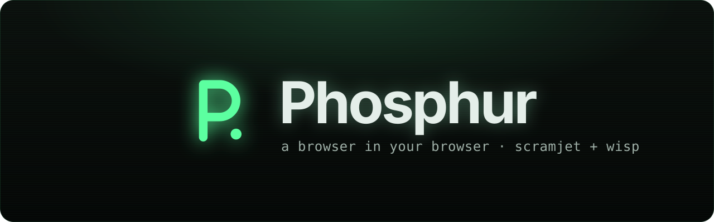

<h1 align="center">
  
</h1>

<div align="center">

[](https://github.com/etcherfx/Phosphur/blob/main/LICENSE)
[](https://github.com/etcherfx/Phosphur/issues)
[](https://github.com/etcherfx/Phosphur/releases/latest)

**A tabbed browser in your browser, powered by Scramjet and Wisp.**

</div>

## 📖 Table of Contents

- [✨ Features](#-features)
- [⚙️ Setup](#️-setup)
- [🔧 Configuration](#-configuration)
- [🐳 Docker](#-docker)
- [⌨️ Keyboard shortcuts](#️-keyboard-shortcuts)
- [🧪 Development](#-development)
- [📜 License](#-license)
- [📝 Credits](#-credits)

## ✨ Features

- **Real tabs.** Open, close, drag to reorder and switch tabs; each keeps its own page, history and state. On small screens the tab strip becomes a tab sheet.
- **Omnibox.** Type a URL, a bare domain or a search. Choose DuckDuckGo, Google, Bing, Brave, Startpage or your own `%s` template.
- **Scramjet v2.** Pages run through [Scramjet](https://github.com/MercuryWorkshop/scramjet)'s controller API, with end-to-end encrypted **libcurl** or **Epoxy** transports over [Wisp](https://github.com/MercuryWorkshop/wisp-protocol). You can switch transports live without reloading.
- **Bring your own Wisp server.** Use the built-in `/wisp/` endpoint or point Phosphur at any `ws://`/`wss://` Wisp server. A status dot shows whether it's reachable and its latency.
- **History and bookmarks,** stored only in your browser (IndexedDB), with a New Tab page showing both.
- **Session restore.** Reopens the tabs you had open last time.
- **Cloaking.** Open Phosphur in an `about:blank` tab, disguise the tab as Google Drive, Classroom, Canvas, Wikipedia or anything else, and set a panic key that instantly leaves for a safe page.
- **Phosphor glow.** Dark-first design with light and system themes and four accent colors. Fonts are self-hosted, and it's installable as a PWA.

## ⚙️ Setup

Phosphur runs on [Bun](https://bun.sh) (1.2 or newer).

1. Install dependencies:

   ```sh
   bun install
   ```

2. Build the site:

   ```sh
   bun run build
   ```

3. Start the server:

   ```sh
   bun run start
   ```

Then open <http://localhost:8080>.

> [!NOTE]
> Service workers only run in a secure context. Serve Phosphur over HTTPS, or use `localhost` while testing.

## 🔧 Configuration

The server is configured with environment variables. Invalid values log a warning and fall back to the default.

| Variable                  | Default   | Description                                                                    |
| ------------------------- | --------- | ------------------------------------------------------------------------------ |
| `PORT`                    | `8080`    | Port to listen on.                                                             |
| `HOST`                    | `0.0.0.0` | Interface to bind.                                                             |
| `LOG_LEVEL`               | `info`    | Wisp server logging: `debug`, `info`, `warn`, `error` or `none`.               |
| `WISP_MOTD`               | _(none)_  | Message of the day sent to Wisp v2 clients.                                    |
| `WISP_HOSTNAME_BLACKLIST` | _(none)_  | Comma-separated regular expressions for hostnames the Wisp server won't reach. |
| `WISP_ALLOW_PRIVATE_IPS`  | `false`   | Allow connections to private network addresses.                                |
| `WISP_ALLOW_LOOPBACK_IPS` | `false`   | Allow connections to loopback addresses (e.g. `127.0.0.1`).                    |

Browser-side settings (theme, search engine, transport, custom Wisp server, cloaking) live in **Settings** inside the app (`phosphur://settings`).

## 🐳 Docker

```sh
docker build -t phosphur .
docker run -d -p 8080:8080 --name phosphur phosphur
```

Pass any of the variables above with `-e`, for example `-e WISP_MOTD="hello"`.

## ⌨️ Keyboard shortcuts

These work in the shell and inside open pages. They avoid Ctrl+T/W/N, which browsers don't let pages override.

| Shortcut            | Action                |
| ------------------- | --------------------- |
| `Alt+T`             | New tab               |
| `Alt+W`             | Close tab             |
| `Alt+1` – `Alt+8`   | Go to tab 1–8         |
| `Alt+9`             | Go to the last tab    |
| `Alt+[` / `Alt+]`   | Previous / next tab   |
| `Ctrl+L` or `Alt+D` | Focus the address bar |
| `Ctrl+R` or `F5`    | Reload the tab        |

## 🧪 Development

```sh
bun run dev        # Astro dev server with the /wisp/ endpoint attached
bun run check      # type-check
bun run lint       # ESLint
bun run format     # Prettier
bun run test       # unit tests
bun run test:e2e   # end-to-end tests (needs `bun run build` first)
```

The end-to-end tests drive Chromium through Playwright. Install it once with `bunx playwright install chromium`.

The proxy runtime (Scramjet, the Scramjet controller and both transports) is pinned to exact versions and copied into `public/vendor/` by `bun run vendor`, which runs before every `dev` and `build`.

## 📜 License

Phosphur is released under the [MIT License](LICENSE).

It serves unmodified builds of [Scramjet](https://github.com/MercuryWorkshop/scramjet), the Scramjet controller, [libcurl-transport](https://github.com/MercuryWorkshop/CurlTransport), [epoxy-transport](https://github.com/MercuryWorkshop/epoxy-transport) and [wisp-js](https://github.com/MercuryWorkshop/wisp-js), which are licensed under the **GNU AGPL-3.0**. Their source is available at the linked repositories.

## 📝 Credits

- [Mercury Workshop](https://github.com/MercuryWorkshop) for Scramjet, Wisp and the transports
- [Astro](https://astro.build), [Svelte](https://svelte.dev) and [Bun](https://bun.sh)
- [Lucide](https://lucide.dev) icons
- [Inter](https://rsms.me/inter/) and [JetBrains Mono](https://www.jetbrains.com/lp/mono/) typefaces
